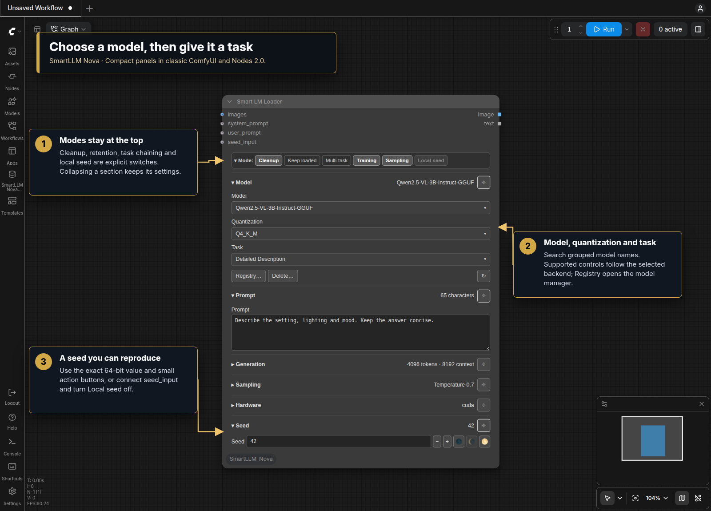

# ComfyUI SmartLLM Nova

The Nova editors use compact themed panels in classic ComfyUI and Nodes 2.0.
Find the five nodes under **🌒 SmartLLM Nova**. See [Nova panels](Readme/Nova_Panels.md)
for sections, connection overrides and seed handling. The design is inspired by
DaSiWa and adapted from the Eclipse Nova panel approach.

Nova uses separate node IDs, `/smartllm-nova/` routes and `SmartLLMNova.*`
settings, so it can be installed alongside the original SmartLLM pack. Models
and inference backends retain their existing loading and verification behavior.
Choose **Settings → SmartLLM Nova → Appearance → Node design** for Neutral (default), the other built-in palettes or [custom JSON themes](Readme/Node_Design.md). The setting and reload action belong only to this repo.
Bundled themes are extracted once from `.defaults/themes/` into the user-owned
`themes/` folder. Updates preserve edits and deletions.

One adaptive interface for vision-language models, text models, WD14 taggers,
Florence grounding, and YOLO detection—plus a registry manager that keeps model
identity, acquisition, and trust decisions explicit.

Version **1.0.0** is the initial Nova release. It includes five panel editors and runs independently of Eclipse.


## Visual tour

Start with the [visual tour](Readme/Visual_Tour.md) for the model/task panel,
chained tasks, detection, converters and Registry Manager, including its
[Docker Images walkthrough](Readme/Registry_Manager.md#docker-images).



## Why use it?

- **One language-model node** adapts to vision, text, and tagger families instead
  of exposing every backend control at once.
- **One detection node** covers Florence and Qwen grounding tasks alongside YOLO
  bounding-box and segmentation models.
- **A matching postprocessor** converts structured detections into selectable
  masks and SAM2-compatible bounding boxes without requiring Eclipse.
- **Several execution backends** share one registry-driven model selector,
  including Transformers, GGUF, Ollama, vLLM, SGLang, and llama.cpp.
- **Verified acquisition** records model source, immutable revision, integrity,
  and provenance before committing local files.
- **Less canvas work** keeps each node's settings in one panel. Editing and
  lifecycle events update the relevant controls; the editors do not use repeated
  graph scans or native-widget visibility helpers.
- **Separate identity** keeps the Nova node catalog and settings apart from the
  original pack. Replace original nodes explicitly when adopting the new editors.

## Using the nodes

### Start with Smart LM Loader

Search for `Smart LM Loader [SmartLLM Nova]` in **Add Node**. Choose a registered
model, then select the task it should perform. The interface responds to the
model family: a vision model exposes image-aware tasks, while text-only and
tagger models show their relevant inputs.


The selected task loads its task-specific system prompt automatically, so
`user_prompt` is normally empty for tasks such as Detailed Description. Use it
only for additional information, a question, or constraints that are not already
expressed by the task. Connecting `system_prompt` is an explicit override: it
switches the node to Direct Chat and bypasses the default task prompt templates.
The connected text becomes the complete system instruction, so it must contain
every important role, objective, constraint, and output-format requirement.
`user_prompt` then supplies the user message or source material for that custom
instruction.

The image input is optional for text-only tasks. Output sockets return generated
text plus an image when the selected task supports one.

Some generative tasks intentionally use `user_prompt` as their source material:

- For a Wan or LTX image-to-video task, connect the starting image and describe
  the intended motion, action, dialogue, style, or camera behavior in
  `user_prompt`.
- For MiniMax H3, choose the T2VA, I2VA, FL2VA, or L2VA timeline task matching
  zero, one first-frame, one first-frame plus an optional last-frame reference,
  or one last-frame image. The explicit FL2VA task accepts the first frame alone
  because the downstream H3 encoder can enforce its separately connected last
  frame; attaching both frames also lets the VLM reason about endpoint differences.
  The compact, duration-neutral **MiniMax H3 Scene** task infers T2VA/I2VA/FL2VA
  from zero/one/two images. Leave `user_prompt` empty to have SmartLLM create an
  original one-shot story, grounding it in one image or connecting two endpoint
  images when supplied. This automatic story mode adds suitable sound and music,
  and uses dialogue only when the scene supports it. You can instead provide a
  short description of what should happen and SmartLLM generates the required H3
  format. You can request a shot count and views in natural language—for example,
  “tell this in 3 shots: side, POV, then overhead”—or ask for a Tracking Shot by
  naming the person or object to follow. For image-based H3 modes, the VLM uses
  the actual reference image as visual ground truth. A one-image FL2VA response
  briefly grounds the visible source state and then continues into the complete
  requested shot timeline; it does not stop at a caption or add exhaustive
  clothing, lighting, or scenery details. The image controls the subjects and
  available scene; a nonempty `user_prompt` controls what happens and prevents
  unrelated invention. Every H3 task returns the same three generator-ready
  fields. If you request no background music, no
  score, or no soundtrack, `non_diegetic_music` is set to `N/A` while dialogue,
  ambience, and action sounds remain in `overall_soundscape` unless you also
  request silence. Timeline task labels are duration-neutral; their prompt writer
  uses H3's 15-second maximum as its shot-planning range unless `user_prompt`
  asks for a shorter duration.
- For **Song Lyrics**, enter a short story, theme, mood, or song concept in
  `user_prompt`. Genre, language, tempo, or structural preferences can be added
  when they matter. The result is a structured lyric sheet that can be copied
  into Suno, Mureka, or another music-generation tool.
- For **MiniMax Music 3**, use a text-capable LLM with a song concept or existing
  lyrics in `user_prompt`. You can also chain **Song Lyrics → MiniMax Music 3**.
  Concepts compose a complete song; structured lyrics and Song Lyrics output
  convert with sung words retained in code and only the caption generated.
  The result is one JSON string with `caption` and `lyrics`. Connect it to
  **Split MiniMax Music 3 [SmartLLM Nova]** → `song_json`, then connect its two
  STRING outputs to the native Music 3 encoder's `caption` and `lyrics` inputs.
  Alternatively, connect the JSON directly to
  **Text Encode MiniMax Music 3 [Smart Model Loader]** → `song_json`.
  [Music 3 usage and output format](Readme/MiniMax_Music_3.md).
- For **YuE2 Music**, enter a song concept or chain **Song Lyrics → YuE2 Music**. Concepts
  compose style and complete lyrics; structured sheets and supplied song JSON
  retain lyrics in code. Connect the result to **Split YuE2 [SmartLLM Nova]**, then
  connect `style` and `lyrics` to both native YuE2 generators. ABC planning stays
  native and optional. [YuE2 usage, preservation and wiring](Readme/YuE2.md).

These cases do not require a custom `system_prompt`; selecting the task still
loads the appropriate instructions automatically.

H3 images connected here are visual references for the VLM that writes the
prompt. They do not configure the downstream MiniMax H3 encoder. Connect the
actual first/last keyframes to that encoder separately, in the order its workflow
requires; the FL2VA prompt-writing task does not require its optional last-frame
reference when the encoder already receives that frame.

### Use the mode bar and sections

The top mode bar controls `Cleanup`, `Keep loaded`, `Multi-task`, `Training`, `Standard`/`NSFW`,
`Sampling` and `Local seed`. Open **Model** for model/quantization/task selection,
Registry, Delete and Refresh actions. Deletion requires confirmation.

Open **Prompt**, **Generation**, **Sampling**, **Hardware**, **Tagging** or **Seed**
to edit the relevant settings. Pin sections to keep several open. Collapsing a
section preserves its values and does not disable processing. `Sampling` controls
whether custom sampling parameters are applied. `Local seed` can be turned off
when `seed_input` is connected; the upstream value then takes priority.

### Chain tasks in one execution

Enable `Multi-Task` to expose Task 2 through Task 4. Each active stage receives
the previous stage's text and passes its result forward. This is useful for a
visual description → prose conversion → prompt refinement sequence without
adding several model nodes.


Set unused stages to `None`. The final active stage becomes the node's text
output, while the image output remains available for compatible workflows.

### Switch to WD14 tagging

Selecting a WD14 registry entry replaces language-generation widgets with the
tagger's general threshold, character threshold, and underscore-formatting
controls.


Connect an image and consume the generated tags from the text socket. The image
socket passes the source image through for downstream routing.

### Run YOLO detection

Search for `Smart Detection [SmartLLM Nova]`, select a YOLO registry model, and
optionally filter among the classes that specific detector knows. For example,
the face-specific `face_yolov8m` model can use `face`; other registered models
specialize in regions such as eyes, faces, hands, or people. Detector-specific
confidence, NMS, filtering, and region-selection controls appear automatically.


The node returns an annotated image, a combined mask, Impact-compatible `SEGS`,
and structured detection data.

### Ground phrases and adjust regions

Florence and compatible Qwen models expose language-directed tasks such as
Caption to Phrase Grounding. Enter focused parts such as `eye;face;mouth`; the
semicolon-separated phrases are run as individual targets and their regions are
merged. Enable `Preview boxes` to annotate the result and open **Adjustments** for
drop-size, crop-factor, and dilation controls.


Smart Detection modes are `Cleanup`, `Keep loaded`, `Preview boxes` and
`Local seed`. Detection, Adjustments, Sampling, Hardware and Seed have their own
sections. Registry and Delete are in Model. The selected model and task determine
which controls are meaningful.

### Convert detection data to masks and boxes

Connect Smart Detection's `image` and `data` outputs to
`Detection to Bboxes [SmartLLM Nova]`. The converter accepts regular boxes, OCR quad
boxes, and polygons; it can combine them into one mask or return selected regions
separately, with optional inversion, grow/shrink, and blur processing. Its bbox
output uses the established `BBOXES` structure for downstream tools such as SAM2
Ultra.

The converter also has an independent image-analysis mode. Enable
**From image** to detect bright or color-channel regions directly with
threshold and minimum-area controls instead of consuming JSON data.

### Inspect and acquire models

Open **Registry…** in the Model section or use the **SmartLLM Nova**
left-toolbar launcher. The **Models** tab groups fields into Model, Source,
Files & runtime, Integrity and Notes. Both tabs follow this pack's selected theme,
including custom palettes, with matching buttons, mode bars and dialog styling.

A registry entry can define its display name, backend, model family, repository
or model ID, source, immutable revision, vision capability, local-only policy,
expected SHA-256 digests, and description.

Use **Inspect** to validate the form, then **Save Entry** before **Download**.
Download and verification use the saved entry; save edited fields first.
**Verify Local Files** does not download anything. **Delete Local Files** and
**Remove Registry Entry** are
separate confirmed operations: removing an entry does not delete its local model
files.

The **Docker Images** tab reports Docker Engine, daemon-access, user-group, and GPU
runtime readiness, then lists the managed backend images for the selected
platform. Expand **System & GPU details** for diagnostics and each image reference
for its immutable digest. The linked installation guide covers terminal setup.
Managed images can be installed, updated, removed, or have their SmartLLM-managed
containers stopped from this tab. Stop and removal are refused while a SmartLLM
model execution is active, so a running prompt is never interrupted; image removal
is also refused while any container still references the selected image. Image
operations report start, completion, and failure milestones in the ComfyUI console;
select **debug** under SmartLLM's **Log Level** setting to also see filtered Docker pull
progress and command output. **Update / Repair** pulls the configured immutable
image; it does not automatically switch to the latest upstream release. The
Ollama card also offers the supported recommended and legacy runtime versions.
**Install & Select** changes the global Ollama runtime, not an individual registry
entry. The existing managed
container is recreated on its next start while the persistent Ollama model store is
preserved.

## Included nodes

| Node | Inputs | Outputs | Purpose |
| --- | --- | --- | --- |
| `Smart LM Loader [SmartLLM Nova]` | optional images, user/system prompt and seed overrides; panel configuration | image, text | Run registered vision-language, text, or WD14 models |
| `Smart Detection [SmartLLM Nova]` | image; prompt, confidence, NMS, area and seed overrides; panel configuration | image, mask, SEGS, data | Run Florence/Qwen grounding or YOLO detection |
| `Detection to Bboxes [SmartLLM Nova]` | image, optional detection data, mask controls | mask, BBOXES | Convert Smart Detection data or image regions into masks and boxes |
| `Split MiniMax Music 3 [SmartLLM Nova]` | optional song_json override; panel text | caption, lyrics (STRING) | Validate and split song JSON for the native Music 3 encoder |
| `Split YuE2 [SmartLLM Nova]` | optional song_json override; panel text | style, lyrics (STRING) | Validate and split song JSON for both native YuE2 generators |

Nova owns all five implementations and does not require Eclipse at runtime.
Model nodes appear under **🌒 SmartLLM Nova → Loader**, and converters under
**🌒 SmartLLM Nova → Conversion**. Nova uses its own node IDs; workflows made
with the original pack need explicit node replacement to use Nova.

## Supported backends and model families

| Path | Typical use |
| --- | --- |
| Transformers | Local Hugging Face vision-language and text models, including Qwen, Florence, Mistral, and LLaVA-family models |
| GGUF / llama.cpp | Quantized local language and vision-language execution |
| Ollama | Models served by an Ollama runtime |
| vLLM / native vLLM | High-throughput model serving, locally or through the managed Docker path |
| SGLang | Structured high-throughput model serving |
| WD14 | Image tagging with independent general and character thresholds |
| YOLO | Bounding-box and segmentation detection |

Backend availability depends on the optional packages or services installed in
your ComfyUI environment. The base installation does not force every compiled
runtime onto the user.

## Installation

Clone into ComfyUI's `custom_nodes` directory, then install dependencies using
ComfyUI's Python environment:

```bash
git clone https://github.com/r-vage/ComfyUI_SmartLLM_Nova.git custom_nodes/ComfyUI_SmartLLM_Nova
cd custom_nodes/ComfyUI_SmartLLM_Nova
python -m pip install -r requirements.txt
```

Restart ComfyUI and refresh the browser. Settings appear under
**SmartLLM Nova → Configuration** and **Appearance**, using `SmartLLMNova.*` IDs.

Install compiled or backend-specific integrations only when needed:

```bash
python -m pip install -e ".[sml]"
```

Docker backends require Docker separately. See the
[general Docker guide](Readme/Docker_Installation_Guide.md) or
[Linux Docker guide](Readme/Docker_Installation_Guide_Linux.md).

## Compatibility and ownership

- SmartLLM registers exactly the five nodes listed above and owns the
  `/smartllm-nova/...` API namespace, registries, Registry Manager, model-acquisition
  state, Docker configuration, and private `config.json`.
- Its model path, retry policy, log level, Hugging Face and ModelScope
  credentials, and `SmartLLMNova.*` settings belong to this repository.
- Startup materializes bundled defaults while preserving local data. It does
  not import another pack's configuration or credentials.
- Duplicate Nova providers or already registered Nova routes block registration.
  The original SmartLLM and Eclipse packs can remain installed independently.
- Optional Eclipse utilities consume the image, text, mask, SEGS and data outputs.

## Security defaults

Mutation routes are POST-only, same-origin protected, limited to bounded JSON
objects, and loopback-only in ComfyUI multi-user mode. Credentials are write-only
and stored with private permissions. Remote model acquisition resolves immutable
revisions, verifies integrity, commits atomically, and writes provenance records.
YOLO uses restricted loading, while managed Docker reuse is tied to immutable
image and container-spec identity.

Repository-supplied Python model code is unsupported. Transformers Auto-class
loads explicitly deny remote code, vLLM is never launched with its remote-code
flag, and Florence uses SmartLLM's local vendored implementation. Read
[Security and model integrity](Readme/LLM_Security_Warning.md) before adding an
untrusted model source.

## Guides

- [Smart LM Loader guide](Readme/Smart_LM_Loader_Guide.md)
- [Smart Detection guide](Readme/Smart_Detection_Guide.md)
- [Registry Manager](Readme/Registry_Manager.md)
- [Model repository reference](Readme/Model_Repos_Reference_Links.md)
- [Copy-paste model registry reference](Readme/Model_Repos_Reference_CP.md)
- [Security and model integrity](Readme/LLM_Security_Warning.md)
- [User data and bundled defaults](Readme/User_Data.md)
- [Third-party notices](THIRD_PARTY_NOTICES.md)

For bugs and feature requests, use the
[GitHub issue tracker](https://github.com/r-vage/ComfyUI_SmartLLM_Nova/issues).

Licensed under Apache-2.0. See [LICENSE](LICENSE) and
[THIRD_PARTY_NOTICES.md](THIRD_PARTY_NOTICES.md).
