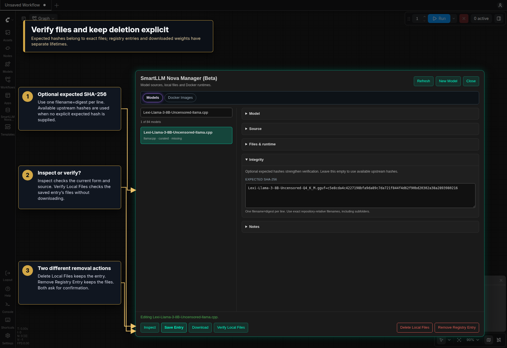
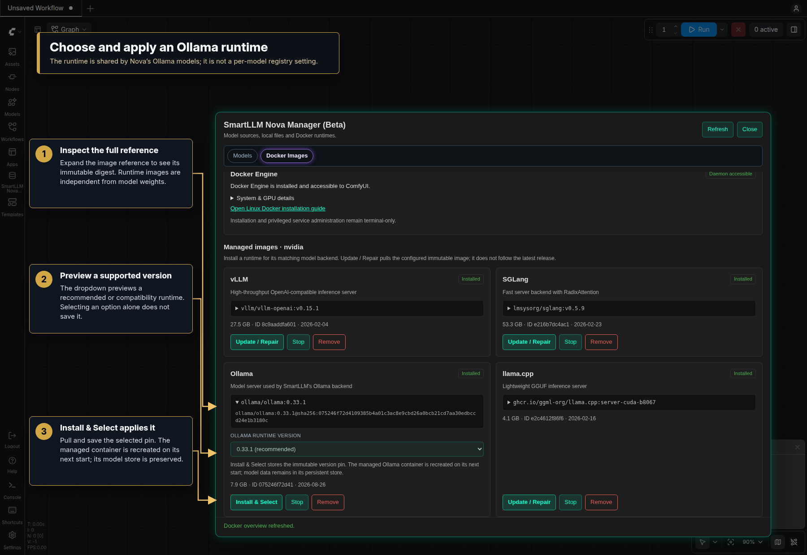

# SmartLLM Nova Registry Manager

Registry Manager brings model sources, downloaded files and Docker runtimes into
one window. Open **Registry…** in a node's Model section, use the **SmartLLM Nova**
sidebar launcher, or choose **Open SmartLLM Nova Manager (Beta)** from the
application menu. The classic menu also has a launcher.

The manager follows **Settings → SmartLLM Nova → Appearance → Node design**.
Buttons, selected tabs, fields, cards and the dialog border/shadow use the same
palette as the nodes. Neutral is the default; the screenshots below use Jade to
make the shared styling easier to see. Custom JSON themes work here too. Changing
or reloading a theme updates an already-open manager without discarding its form.

- [Browse the registry](#browse-the-registry)
- [Add or edit a model](#add-or-edit-a-model)
- [GGUF files and quantization](#gguf-files-and-quantization)
- [Integrity and local files](#integrity-and-local-files)
- [Docker Images](#docker-images)
- [Choose an Ollama runtime](#choose-an-ollama-runtime)
- [Common questions](#common-questions)

## Browse the registry

Search by name, backend or family in the left column. Each entry shows its backend,
origin and local status. Selecting a row loads that entry into the form. **Refresh**
reloads the active tab; finish and save your edits before refreshing the Models tab.

| Local status | Meaning |
| --- | --- |
| `available` | A local candidate was found. For a GGUF entry, this can mean at least one listed quantization is present; it does not certify every variant or replace verification. |
| `missing` | The manager did not find a usable local candidate at the configured location. The registry entry remains available to inspect or download. |
| `managed` | Ollama manages this model in its own store; this label does not mean it has already been downloaded. |

`curated` entries originate from the bundled catalog, `user` entries were added by
the user, and `local` is also used for discovered YOLO models. These labels describe
where an entry came from, not the result of a hash check.

## Add or edit a model

1. Select an existing entry, or click **New Model** for an empty form.
2. In **Model**, set the registry name, backend, family and vision capability.
   A saved entry keeps its backend. Use New Model to register the same weights
   with another backend.
3. In **Source**, enter the repository/model ID and download source. A blank
   revision resolves to the source's default revision; a branch or tag is resolved
   to an immutable commit when inspecting or saving a new/changed source.
4. Complete **Files & runtime** when it appears. Its controls depend on the backend.
   Add optional expected hashes under **Integrity** and a description under **Notes**.
5. Click **Inspect** to validate the form and resolve the source. Review the returned
   fields, then click **Save Entry**.
6. Click **Download** when you want the weights on disk. The node model menus refresh
   when entries are saved or removed.

Sections collapse independently. Closing one keeps its values. During an operation,
controls are temporarily disabled; the status line shows completion or the error.

| Section | What belongs here |
| --- | --- |
| Model | Name shown in model selectors, execution backend, model family and vision capability. Setting vision capability does not add image support to a text-only model. |
| Source | Hugging Face repository, targeted ModelScope source, Ollama name/tag, or an existing local model path. |
| Files & runtime | GGUF filenames and quantizations; YOLO checkpoint/type; or server quantization and supported parallelism settings. Hidden when the backend needs none of these. |
| Integrity | Optional `filename=SHA-256` entries. Hidden for local-only entries and Ollama, which uses its own model store. |
| Notes | A saved description for your own catalog. |

Hugging Face is the usual repository source. ModelScope is supported for targeted
GGUF/llama.cpp entries, not complete Transformers-style snapshots. Ollama uses an
Ollama model name and tag rather than a Hugging Face revision.

**Use an existing local model only** replaces repository fields with a path below
the configured LLM model folder and disables Download. The path must already exist.
For YOLO, select a `.pt` filename present in the configured `ultralytics/bbox` or
`ultralytics/segm` folders instead. Ollama does not support this local-only form.

New entries normally go into `registry/user_models.json`; YOLO entries go into
`registry/yolo_models.json`. Editing an existing entry updates its runtime registry
file. The manager does not rewrite bundled `.defaults` files. See [user data](User_Data.md)
for backup locations.

## GGUF files and quantization

Use the repository's exact filenames. A **GGUF file pattern** contains `{quant}`;
the manager substitutes the selected quantization when acquiring files. For
example, the bundled Qwen2.5-VL-3B entry uses:

| Field | Example from the bundled entry |
| --- | --- |
| Repository / model ID | `lmstudio-community/Qwen2.5-VL-3B-Instruct-GGUF` |
| GGUF file pattern | `Qwen2.5-VL-3B-Instruct-{quant}.gguf` |
| Vision mmproj filename | `mmproj-model-f16.gguf` |
| Download quantization | `Q4_K_M` |

**Quantizations** lists the variants exposed by this registry entry, separated by
commas. **Download quantization** chooses which variant Download and Verify Local
Files act on. It does not change the quantization already selected in a workflow
node. Save changes to the quantization list or file pattern before downloading.

A vision GGUF may need a matching `mmproj` projection file. Enter the exact filename
from that repository; an unrelated projection file cannot supply the correct
vision support. Text-only models normally leave this field empty.

For vLLM/native vLLM/SGLang, **Server quantization** is a runtime option rather than
a GGUF filename suffix. Tensor/data parallelism fields appear only for the
backends that expose them. Use settings supported by the selected model and hardware.

## Integrity and local files

Expected hashes use one `filename=digest` pair per line, with the exact
repository-relative filename and a 64-character SHA-256 digest. Include subfolders
when present. Leave the field empty if you do not have trusted expected hashes;
the acquisition path uses available upstream hashes. A recorded local hash is
useful for later change detection, but is not an independent source guarantee.

| Action | Effect |
| --- | --- |
| Inspect | Validates the current form and resolves a new/changed source. Does not save the entry or download model weights. |
| Save Entry | Validates and saves the form. Does not download weights. |
| Download | Acquires the **saved** entry, using the selected GGUF quantization where applicable, with the shared verification path. |
| Verify Local Files | Checks the saved entry's local files without downloading them. Unavailable for Ollama. |
| Delete Local Files | Deletes local model files after confirmation; keeps the registry entry. |
| Remove Registry Entry | Removes the entry after confirmation; keeps local model files. |

**Save edited fields before Download or Verify Local Files.** These actions operate
on the saved entry, not an unsaved draft. In contrast, Inspect reads the current
form. Removing a registry entry can leave an existing workflow referencing a name
that is no longer registered.

## Docker Images

This tab manages the software that serves Docker-backed models. Model weights
belong to the Models tab. Native Transformers, GGUF, WD14, YOLO and native vLLM
do not need a managed image from this tab.

1. Choose **Auto-detect** under **Image platform**, or explicitly inspect NVIDIA /
   CUDA, AMD / ROCm or CPU images. This selects which runtime images the manager
   displays and operates on; it does not change a node's device setting.
2. Check **Docker Engine**. The badge reports daemon access, and **System & GPU
   details** shows the platform, Docker CLI/daemon and available GPU diagnostics.
   Details open automatically when setup needs attention. A reachable daemon alone
   does not prove that a particular model or GPU runtime is compatible.
3. Open the linked installation guide if setup is incomplete. Docker installation,
   group membership and privileged service administration stay in the terminal.
   After changing group membership, start a fresh login session and restart ComfyUI.
4. Find the card matching the model backend: vLLM, SGLang, Ollama or llama.cpp.
   The choices vary with Image platform. Expand the image reference to inspect its
   full immutable digest.
5. Use the appropriate action, then check the status line. **Refresh** reloads the
   overview after changes made outside ComfyUI.

| Card control | What it does |
| --- | --- |
| Installed / Not installed | Reports whether the configured image is present. It does not indicate that a container is running or model weights are ready. |
| Install | Pulls the configured runtime image. |
| Update / Repair | Pulls that configured immutable reference again. It does not automatically move to the latest upstream release. |
| Install & Select | Ollama: pulls the chosen supported runtime and saves its immutable pin. See below. |
| Stop | Stops SmartLLM-managed containers for that backend after confirmation. Keeps the image and model data. |
| Remove | Removes the configured Docker image after confirmation. Refused while any container still references that image. |

Stop and image removal are refused during active SmartLLM execution. A stopped
container may still reference an image, so Stop does not necessarily make Remove
possible. Inspect and remove an unwanted stopped container separately if appropriate.
No model weights are removed through the Docker image buttons.

Image-operation milestones appear in the ComfyUI console. **SmartLLM Nova →
Configuration → Log Level → debug** also shows filtered Docker pull progress.
For installation steps, see the [Linux Docker guide](Docker_Installation_Guide_Linux.md)
or [general Docker guide](Docker_Installation_Guide.md).

## Choose an Ollama runtime

The **Ollama runtime version** selector lists the versions supported by this
installation, including the recommended and legacy compatibility choices. Choosing
one previews its image reference. Click **Install & Select** to pull it and store
the selection; changing the dropdown alone does not update configuration.

The saved runtime applies to Nova's Ollama backend for that platform, not just the
currently selected model entry. The managed container is recreated on its next start and the persistent
model store remains. **Remove** is disabled while previewing a different version,
so it cannot accidentally remove the currently configured image under another label.

## Common questions

| Situation | What to check |
| --- | --- |
| Download is disabled | Save a new entry first. Local-only entries intentionally cannot download. Wait for any current operation to finish. |
| Verify Local Files is disabled for Ollama | Ollama owns its content-addressed model store; this action is for registry-managed local files. |
| Saved fields differ from my draft | Inspect/Save normalizes backend-supported fields and resolves source revisions. Review the validation message when saving fails. |
| A model source cannot be inspected | Check the source ID, revision and repository access. Configure any required credential in this pack's settings. Repository-supplied Python model code remains unsupported. |
| Docker controls are disabled | Check daemon access and setup details; controls are also locked while an operation is running. |
| Docker image is installed but the model is missing | Register/download the model in Models. Runtime images and model weights are separate resources. |
| Colors differ from these screenshots | Select Jade for the pictured palette, or keep Neutral. Both tabs follow this pack's selected design and user theme edits. |

See [node designs](Node_Design.md) for custom palettes and [security and integrity](LLM_Security_Warning.md)
for acquisition and administrative boundaries.
