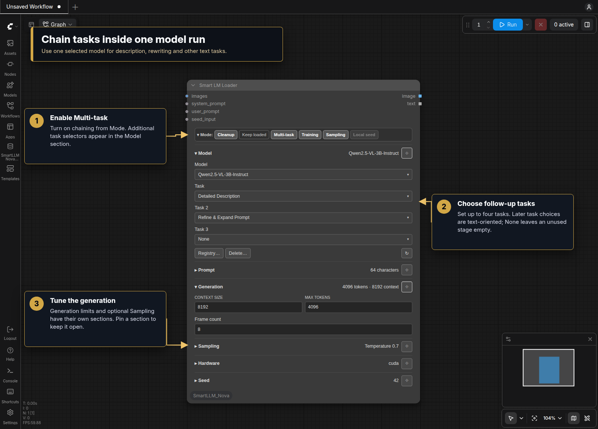
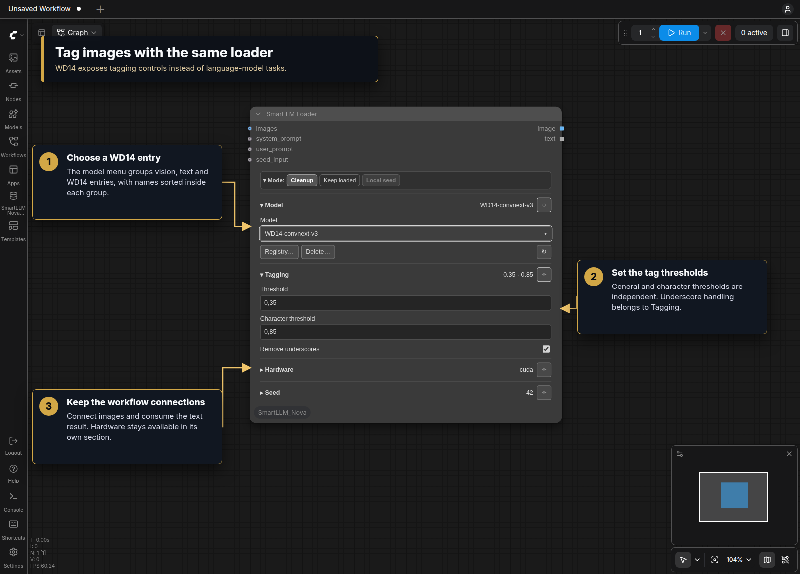
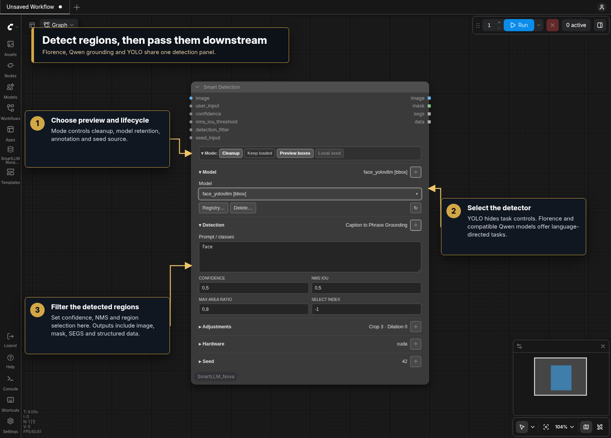
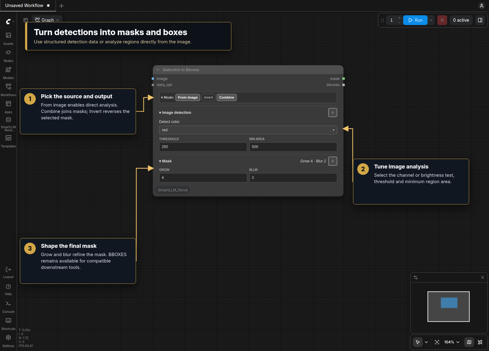
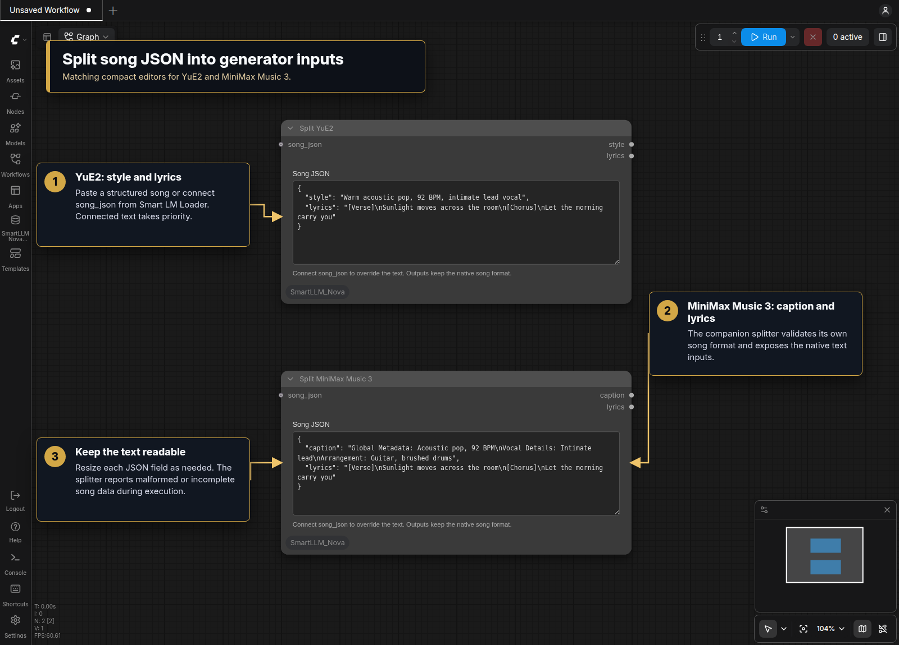
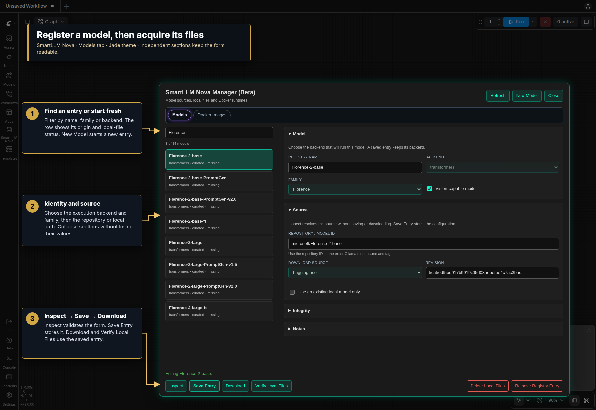
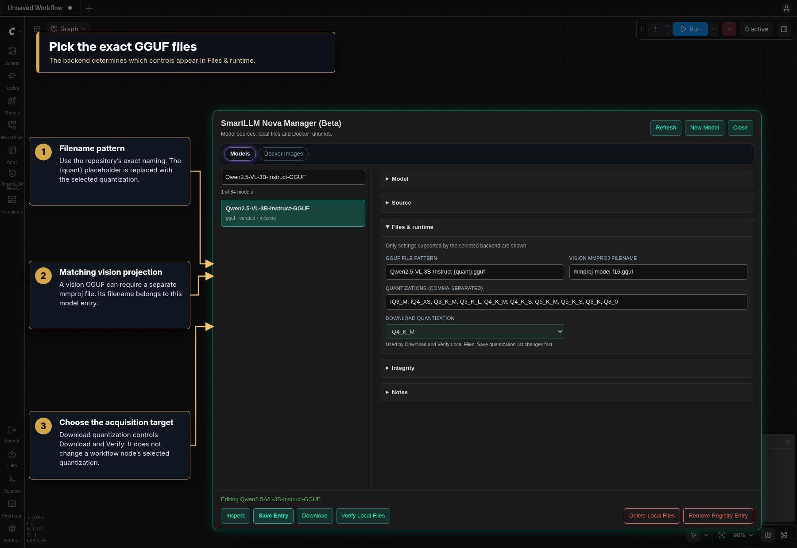
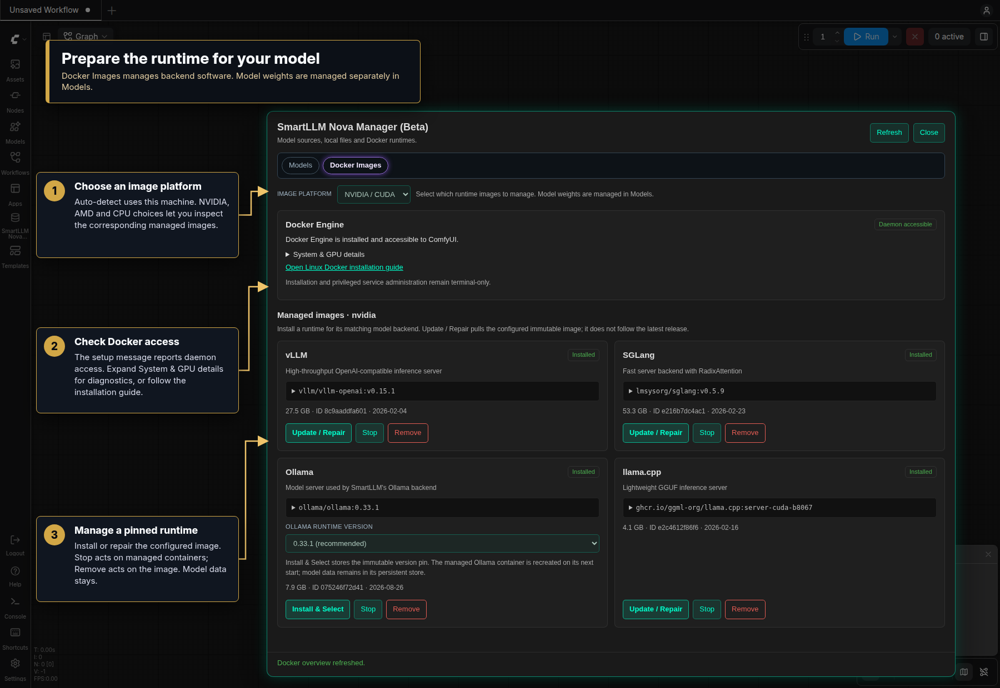

# SmartLLM Nova visual tour

Five compact editors cover model inference, detection and structured song text.
Find them under **🌒 SmartLLM Nova → Loader** or **Conversion**. The screenshots
show the actual Nodes 2.0 interface. Node screenshots use **Neutral**, the default
design; the expanded manager walkthrough uses **Jade**. The same panels work in
classic canvas. Gold callouts are guide annotations. Open a screenshot for its
full-size view.

- [Model, task and seed](#model-task-and-seed)
- [Chain tasks](#chain-tasks)
- [Tag images with WD14](#tag-images-with-wd14)
- [Detect regions](#detect-regions)
- [Convert detections to masks and boxes](#convert-detections-to-masks-and-boxes)
- [Split song JSON](#split-song-json)
- [Inspect and download models](#inspect-and-download-models)
- [Manage Docker runtimes](#manage-docker-runtimes)

## Model, task and seed

**Smart LM Loader** puts Mode above the Model section. Choose a model from the
searchable, grouped list, then select a compatible task. GGUF and llama.cpp models
also expose quantization. Opening the model selector refreshes its registry list;
unavailable saved selections remain visible when restoring a workflow.

Connect `images` for vision tasks. The local Prompt field holds extra instructions;
`user_prompt` can override it, including with a prompt list. A connected
`system_prompt` supplies complete Direct Chat instructions for supported models.

**Local seed** uses the Seed section. Connect `seed_input` before disabling Local
seed to use an upstream value. Small buttons provide −/+, random-each-run,
last-seed and fixed-random actions. The field preserves the full 64-bit value.

## Chain tasks

Enable **Multi-task** to reveal subsequent task selectors in Model. Each completed
stage supplies text to the next. **None** ends the chain, up to four tasks.
Use a model that supports the chosen tasks; Florence's specialized tasks differ
from general text-model capabilities.

**Generation** controls context and output limits. **Sampling** enables custom
sampling values. Open a section to edit it, or pin it to keep it open alongside
another section. Collapsing a section does not disable its processing.

## Tag images with WD14

Choose a WD14 model in the same loader. Task controls give way to **Tagging**,
with separate general and character confidence thresholds and underscore handling.
The image socket passes the source image onward; text carries the generated tags.

## Detect regions

**Smart Detection** supports Florence/Qwen grounding and YOLO detectors. Connect
an image, choose a model, then set a grounding prompt or detector class filter.
Task choices appear for language-directed detection; YOLO uses its own classes.

Confidence, NMS and maximum region-area ratio have optional input overrides.
**Adjustments** holds crop, drop-size and mask dilation. **Preview boxes** annotates
the output. The node also returns masks, Impact-compatible SEGS and detection data.

## Convert detections to masks and boxes

**Detection to Bboxes** accepts an image and optional structured detection data.
Enable **From image** for direct channel/brightness analysis instead. **Combine**
joins masks; **Invert**, grow and blur refine them. The BBOXES output can feed
compatible tools such as SAM2.

## Split song JSON

**Split YuE2** returns `style` and `lyrics`. **Split MiniMax Music 3** returns
`caption` and `lyrics`. Paste JSON into the resizable editor or connect `song_json`
from Smart LM Loader; connected text takes priority. The splitters validate the
structure and preserve the decoded text for the native music nodes.

See [YuE2 wiring](YuE2.md) and [MiniMax Music 3 wiring](MiniMax_Music_3.md) for the
required fields and downstream encoder connections.

## Inspect and download models

Open **Registry…** in Model, or use the **SmartLLM Nova** sidebar launcher.
The manager uses the same theme as the nodes, including custom palettes. **Models**
and **Docker Images** use the familiar mode-bar styling. Search existing entries
on the left, or click **New Model**.

**Model** identifies the backend and family. **Source** holds the repository ID,
revision or existing local path. **Files & runtime** appears for backend-specific
settings; **Integrity** and **Notes** stay collapsible. Closing a section keeps its
values.

1. **Inspect** validates the current form and resolves a new or changed source.
2. **Save Entry** stores it without downloading model weights.
3. **Download** acquires the saved entry with verification. Save edited fields first.
4. **Verify Local Files** checks an existing download without acquiring files.

GGUF entries expose a filename pattern containing `{quant}`, an optional vision
projection file and a **Download quantization** selector. This selector chooses
the manager's download/verification target; it does not overwrite a node's selected
quantization.

**Delete Local Files** keeps the entry. **Remove Registry Entry** keeps the files.
Both require confirmation. The [complete manager guide](Registry_Manager.md)
walks through registration, expected hashes, local-only entries, status labels and
the effect of each action.

## Manage Docker runtimes

**Docker Images** manages the runtime software for Docker-backed models. Choose
**Image platform**, check daemon access, and expand **System & GPU details** when
setup needs attention. The runtime cards show installation status and expandable
image references with their full immutable digests.

**Install** pulls a missing runtime. **Update / Repair** pulls the configured pin
again; it does not silently switch to the latest release. **Stop** acts on managed
containers, while **Remove** acts on the image. These actions keep model weights.
An installed runtime image does not imply that a model has been downloaded.

The Ollama card adds a runtime-version selector. Changing the dropdown previews a
reference; **Install & Select** applies it to Nova's Ollama backend. The persistent
model store stays in place. See the [Docker walkthrough](Registry_Manager.md#docker-images)
and [Ollama selection example](Registry_Manager.md#choose-an-ollama-runtime) for
setup diagnostics, action restrictions and a closer look at the controls.

Choose **Settings → SmartLLM Nova → Appearance → Node design** to change the
palette. Neutral, Jade, Ocean, Amethyst and Amber are included. Users can edit or
add [JSON themes](Node_Design.md); theme changes belong only to this repository.
The compact panel approach is inspired by DaSiWa and updates controls through
editing and lifecycle events, reducing recurring canvas work.
